# 🎵 YR Music

[](https://github.com/uamo11/YR/actions/workflows/ci.yml)
[](https://github.com/uamo11/YR/releases)
[](https://www.rust-lang.org/)
[](LICENSE)

**YR Music** es un cliente de música de alto rendimiento para Android y escritorio desarrollado **100% en Rust**. Diseñado para superar la experiencia de YouTube Music en velocidad, fluidez y consumo de recursos, sin WebViews ni frameworks pesados, con soporte offline completo y procesamiento digital de señales (DSP) en tiempo real.

---

## ✨ Características Principales

- 🎛️ **Ecualizador paramétrico de 5 bandas, Bass Boost & Normalización de volumen:** Motor de audio DSP puro en Rust con filtros biquad de segundo orden en tiempo real (`60 Hz`, `230 Hz`, `910 Hz`, `3.6 kHz`, `14 kHz`), normalización automática de sonoridad (`Normalización de volumen`), saturación suave anti-clipping (`tanh`), panel centrado sin desbordamiento y preajustes audiófilos (*Plano*, *Graves +*, *Rock*, *Pop*, *Electrónica*, *Vocal*, *Acústico*).
- 🎬 **Selector interactivo Canción / Video:** Switch dinámico estilo YouTube Music `[ 🎧 Canción | ▶ Video ]` en el reproductor a pantalla completa, superficie panorámica 16:9 con badge 1080p HD y apertura directa de video nativo en Android.
- 👤 **Apartado de Perfil / Cuenta:** Pantalla completa idéntica a YouTube Music con foto de perfil, identificador de usuario Google (`Antony`, `@IsAntonyVs`), enlace directo a gestión de cuenta Google, accesos a *Tu canal*, *Descargas*, *Historial*, *Tu Recap*, *Insignias*, *Cambiar de cuenta*, *Configuración* y enlaces legales.
- ⚙️ **Configuración categorizada en 10 secciones:**
  - 🧪 **Morphe & Centro familiar:** Experimentos de audio 3D y control familiar.
  - 🔋 **Ahorro de batería y datos móviles:** Streaming reducido a 64 kbps en redes móviles, suspensión de precarga en modo de batería baja y bloqueo opcional de tráfico multimedia fuera de Wi-Fi.
  - 📥 **Descargas inteligentes & Límite de caché de streaming:** Descarga predictiva automática para escucha 100% offline, **Límite de caché de streaming** configurable (`128 MB`, `256 MB`, `512 MB`, `1 GB`, `2 GB`) con purga LRU automática en disco, monitor de almacenamiento y borrado manual de caché.
  - 🔒 **Privacidad y recomendaciones:** Modo incógnito, borrado de historiales y personalización algorítmica de listas según cuenta Google.
- 🎨 **Iconografía oficial Google Material Design:** Todos los iconos del sistema integrados mediante fuente vectorial auténtica de Google Material Icons (58 glifos oficiales pixel-perfect).
- ⚡ **Prefetch predictivo de audio en disco:** Resuelve y descarga automáticamente el audio de la siguiente canción de la cola en segundo plano, logrando saltos de pista instantáneos con latencia cero de red.
- 🎨 **Experiencia visual y táctil ultra fluida:**
  - Hoja de acciones inferior rápida con accesos directos (*Reproducir a continuación*, *Guardar en playlist*, *Compartir*, *Descartar fila*, *Temporizador de apagado* y *Ecualizador*).
  - Carrusel horizontal de búsquedas recientes con portadas cuadradas e historial táctil.
  - Tarjetas de descubrimiento rápido: *Nuevos lanzamientos*, *Rankings* y *Estados de ánimo y géneros*.
  - Vista de Biblioteca con filtros (*Descargas*, *Playlists*, *Canciones*, *Álbumes*, *Artistas*), botón flotante `+ Nueva` y tarjeta gradiente para *"Música que te gustó"*.
  - Iconografía estandarizada Material Design y motor de scroll kinético táctil a 60 FPS sin rebotes ni bloqueos.
- 📥 **Gestor de descargas paralelo con reanudación por bloques:** Descargas aceleradas mediante chunks concurrentes de 1 MB, verificación por hash SHA-256, rollback automático ante fallos de conexión y modo de reproducción offline con shuffle.
- 🛡️ **SponsorBlock integrado:** Omisión automática de intros, interludios no musicales y anuncios patrocinados dentro del audio.
- 🌙 **Temporizador de apagado:** Modo de apagado programable (15, 30, 45, 60 minutos o al finalizar la canción actual).
- 🔊 **Control de volumen interno:** Ajuste de volumen independiente del sistema operativo para máxima fidelidad de escucha.

---

## 📸 Capturas de Pantalla (Android)

| Inicio | Biblioteca | Búsqueda |
|:---:|:---:|:---:|
| 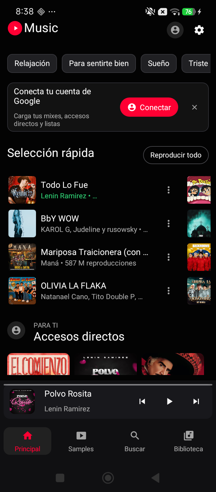 | 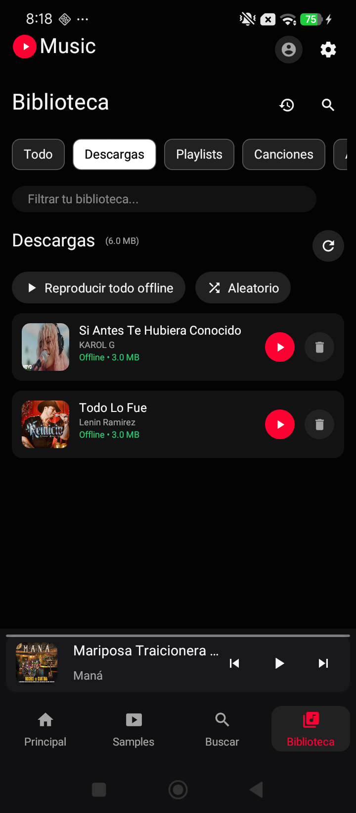 | 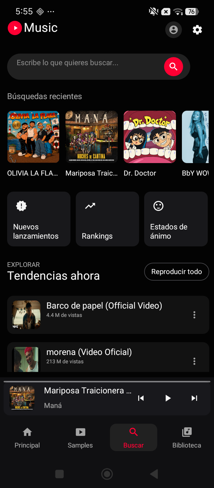 |

| Perfil / Cuenta | Configuración Categorizada | Ahorro de Datos & Batería |
|:---:|:---:|:---:|
| 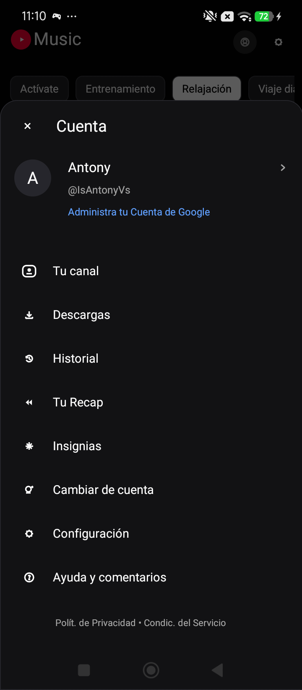 | 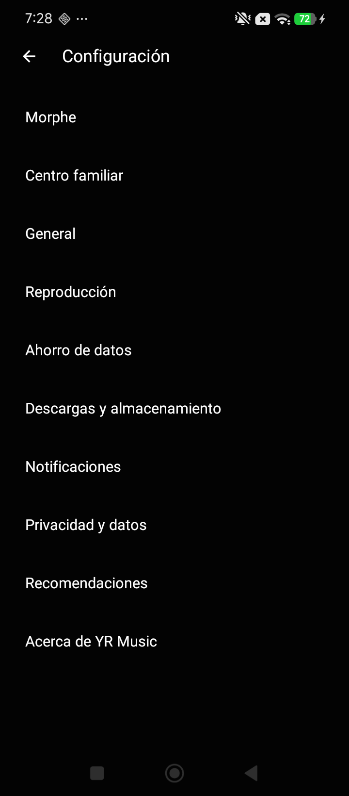 | 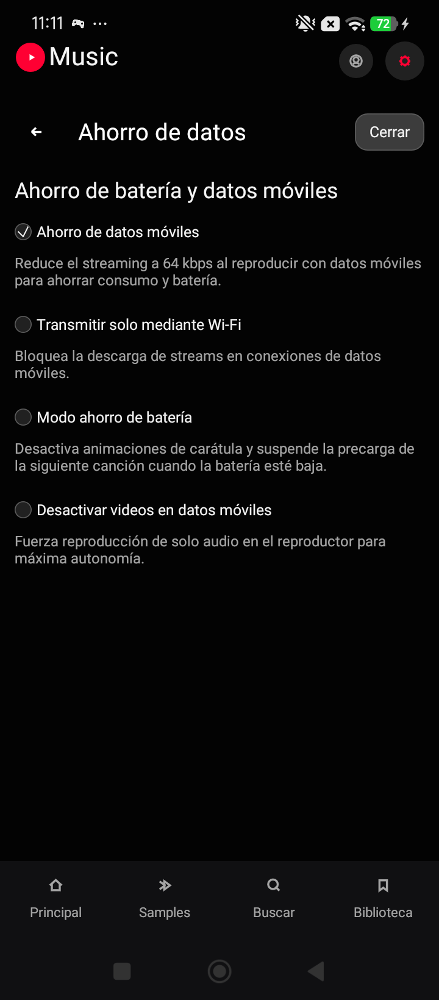 |

| Hoja de Acciones | Ecualizador & Bass Boost | Modo Video Panorámico 16:9 |
|:---:|:---:|:---:|
| 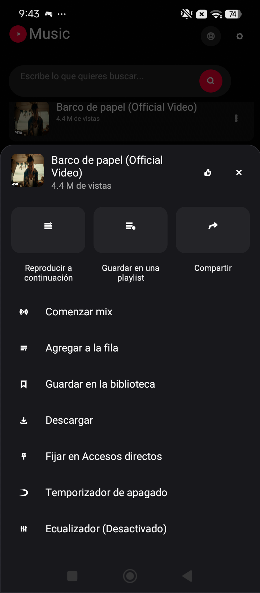 | 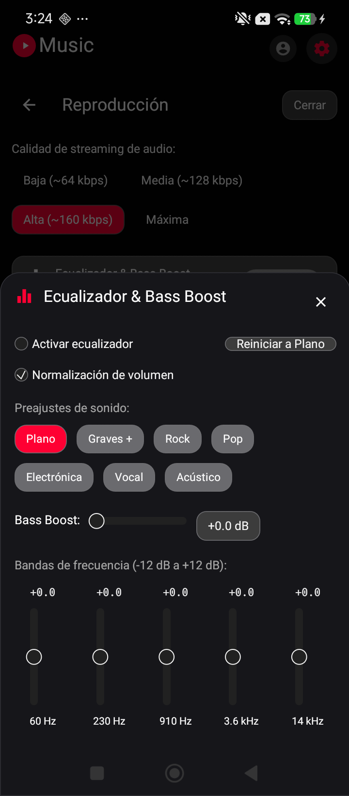 | 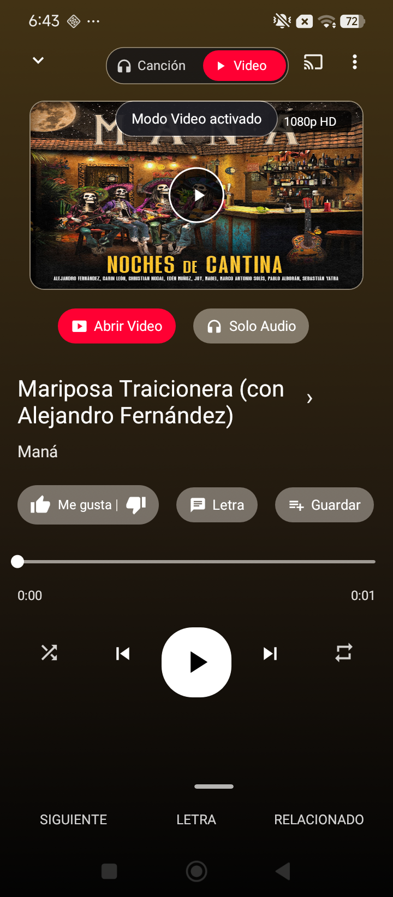 |

| Reproductor & Temporizador | Letras Sincronizadas | Cola Dinámica |
|:---:|:---:|:---:|
| 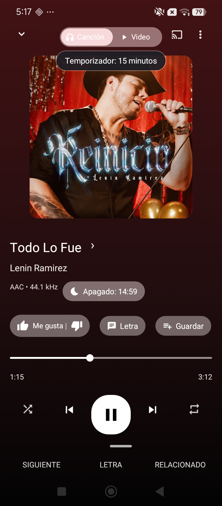 | 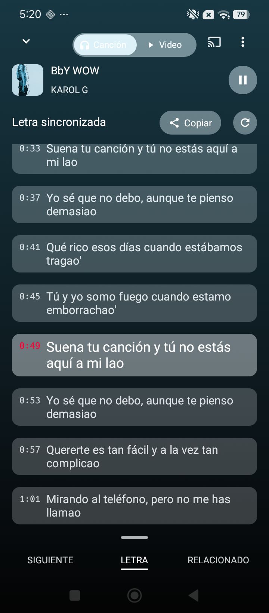 | 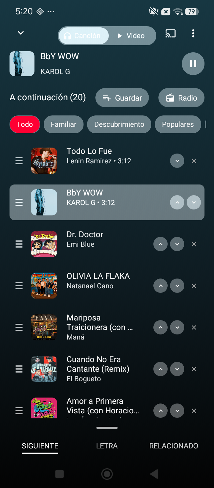 |

---

## 🏗️ Arquitectura (Cargo Workspace)

El proyecto está modularizado en un espacio de trabajo de Cargo limpio y desacoplado:

- [`crates/yr-core`](crates/yr-core): Modelos de dominio (`Track`, `AlbumDetail`, `PlaylistSummary`, `AudioQuality`), cola de reproducción inteligente (`PlaybackQueue` con shuffle determinista y modos de repetición), persistencia atómica en disco (`LibraryStore`), sesiones de cuenta Google y configuración de ecualizador (`EqualizerConfig`).
- [`crates/yr-audio`](crates/yr-audio): Motor de reproducción en hilo dedicado de baja latencia (`AudioEngine`) implementado con `symphonia` + decodificadores PCM nativos (AAC/M4A, MP3, FLAC, Opus, WAV). Incluye procesador de biquads para ecualización en tiempo real y prefetch en caché local.
- [`crates/yr-provider`](crates/yr-provider): Trait asíncrono `MusicProvider` e implementación `YtMusicProvider` sobre llamadas directas HTTPS (InnerTube API con soporte de cabeceras de autorización de cuenta Google, recomendaciones personalizadas y avatares normalizados).
- [`crates/yr-download`](crates/yr-download): Gestor de descargas concurrente multi-hilo (`DownloadManager`) con soporte para peticiones HTTP `Range`, archivos `.part` transaccionales y reanudación automática.
- [`crates/yr-app`](crates/yr-app): Interfaz gráfica nativa construida con `egui` y `eframe` (`android-native-activity` en Android y binario nativo en Linux/macOS/Windows) con motor de scroll kinético táctil a 60 FPS (`SmoothTouchScroller`).

---

## 📦 Descargas e Instalación

Puedes descargar el APK precompilado y firmado para Android en la sección de [Releases de GitHub](https://github.com/uamo11/YR/releases).

1. Descarga el archivo [`yr-music-v0.7.6-android.apk`](https://github.com/uamo11/YR/releases/latest/download/yr-music-v0.7.6-android.apk).
2. Habilita la instalación desde orígenes desconocidos si tu dispositivo lo solicita.
3. Instala y disfruta de música sin publicidad y con la máxima velocidad de respuesta.

---

## 🛠️ Compilación Local

### Requisitos
- **Rust:** Versión stable 1.80 o superior (`rustup default stable`).
- **Android NDK:** r26b o superior (para compilación Android cruzada con `cargo-apk`).
- **Java JDK:** OpenJDK 17+.

### Compilar APK para Android
```bash
cargo install cargo-apk
cargo apk build --release
```
El APK resultante se genera en `target/release/apk/yr_app.apk`.

### Ejecutar en Escritorio
```bash
cargo run -p yr-app --bin yr
```

---

## 📄 Licencia

Este proyecto está bajo la Licencia MIT. Consulta el archivo [LICENSE](LICENSE) para más información.
